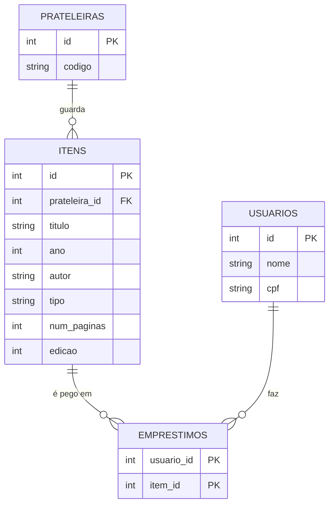

# Trabalho Prático – Sistema de Biblioteca (POO – IFMG Ribeirão das Neves)

## Links da entrega
- **DER (imagem):** [TP3/DER.png](TP3/DER.png)
- **Repositório (código):** _colocar aqui o link deste repositório_
- **Vídeo de apresentação (5 a 10 min):** _colocar aqui o link do YouTube/Drive_

> Lembrete: adicionar todos os membros da equipe como colaboradores no GitHub.

## O que tem em cada pasta
- `TP2/` – sistema orientado a objetos da etapa anterior (sem alterações).
- `TP3/` – armazenamento dos dados em banco relacional com SQLAlchemy (ORM) + SQLite.

## Parte do sistema modelada
Prateleira, Item (livros e HQs), Usuário e Empréstimo.

- **1:N** – uma `Prateleira` guarda vários `Item` (chave estrangeira `itens.prateleira_id` + `relationship`).
- **N:N** – `Usuario` e `Item` se ligam pela tabela de associação `emprestimos`
  (um usuário pega vários itens; um item é pego por vários usuários ao longo do tempo).
- `Livro` e `HQ` herdam de `Item` e ficam na mesma tabela `itens`; a coluna `tipo` diz qual é qual.
- Um empréstimo ativo é uma linha em `emprestimos`; ao devolver, a linha é apagada.



## Arquivos da pasta TP3
- `database.py` – conexão com o banco (engine e Session).
- `models.py` – as classes/tabelas (`Prateleira`, `Item`, `Livro`, `HQ`, `Usuario`) e a tabela associativa `emprestimos`.
- `criar_banco.py` – cria as tabelas e cadastra os dados de exemplo.
- `consultas.py` – as 3 consultas.
- `main.py` – menu da biblioteca (usa o banco).

## Como rodar
```bash
cd TP3
pip install -r requirements.txt
python main.py            # menu completo (cria o banco sozinho na 1ª vez)

# ou, separado (útil para o vídeo):
python criar_banco.py     # criação das tabelas + cadastro dos dados
python consultas.py       # as 3 consultas e seus resultados
```

## Consultas
1. **Empréstimos** – quem está com qual item (JOIN N:N).
2. **Itens por prateleira** – quantidade de itens em cada prateleira, inclusive a vazia (JOIN 1:N + `group_by`).
3. **Usuários com mais itens** – ranking de itens emprestados por usuário (JOIN N:N + `group_by` + `order_by`).
